<p align="center">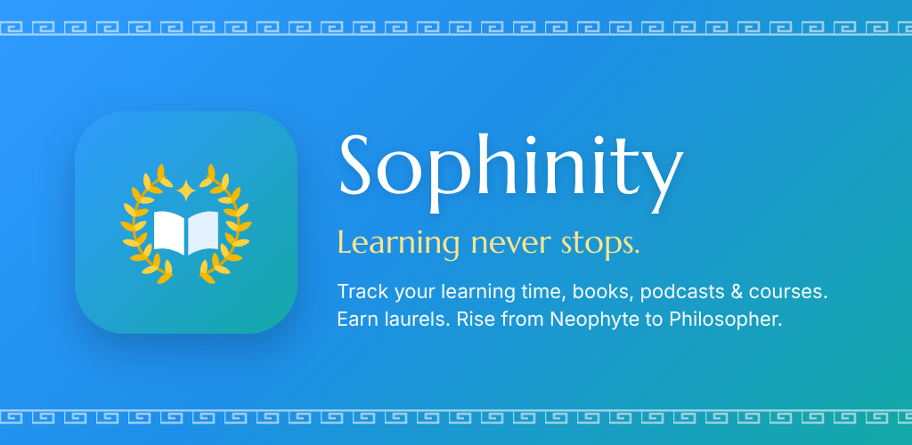</p>

# Sophinity

*Sophia* (σοφία) is Greek for wisdom. **Sophinity** is a learning tracker for lifelong learners: everything you learn **outside formal schooling** — books, audiobooks, podcasts, seminars, courses and self-directed practice — with the metrics to push your skills further. Earn laurels and rise from **Neophyte to Philosopher**.

Native Android, Kotlin + Jetpack Compose, Material 3, targeting **Android 17 (API 37)**. Brand guide: [`docs/brand/BRAND.md`](docs/brand/BRAND.md).

| Today | Stats | Sessions | Library | Goals | Laurels | Laurel medallions |
|---|---|---|---|---|---|---|
| 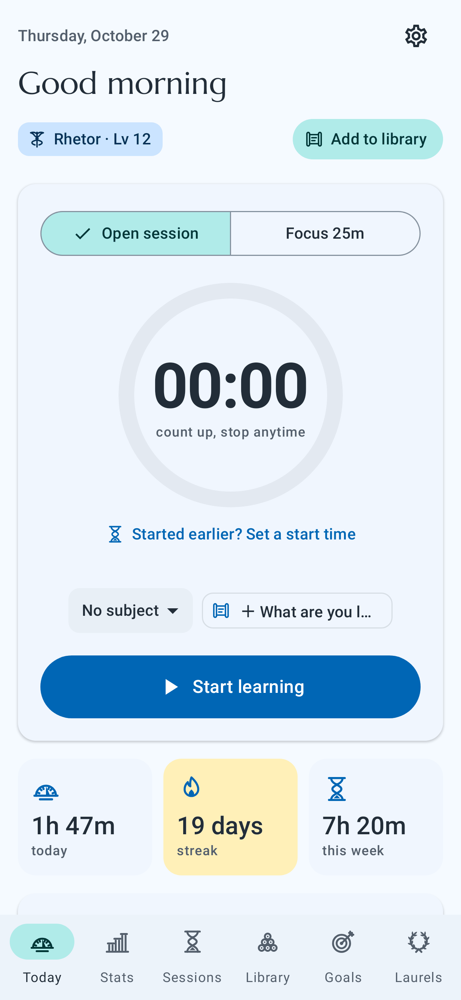 | 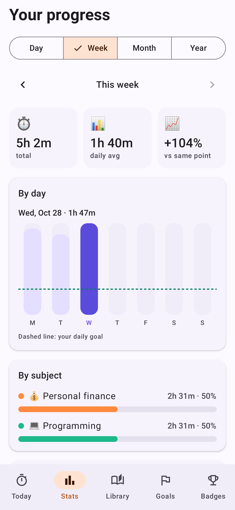 | 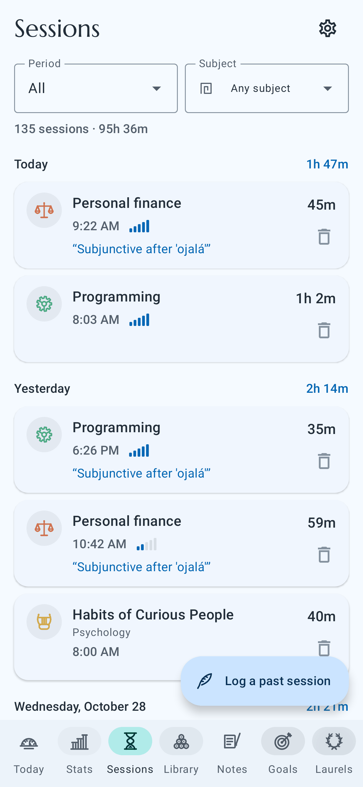 | 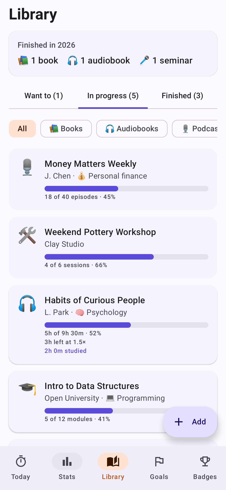 | 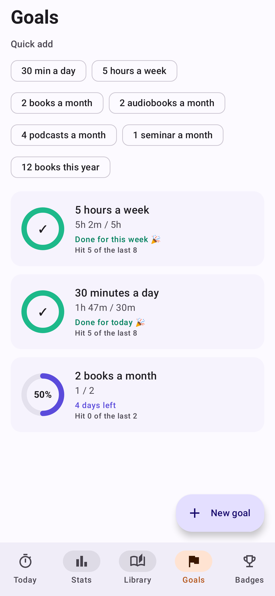 | 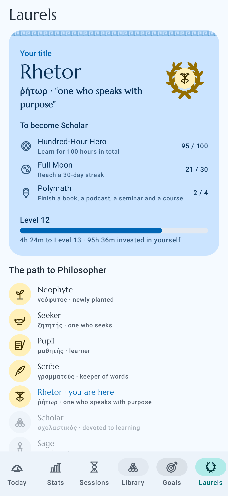 | 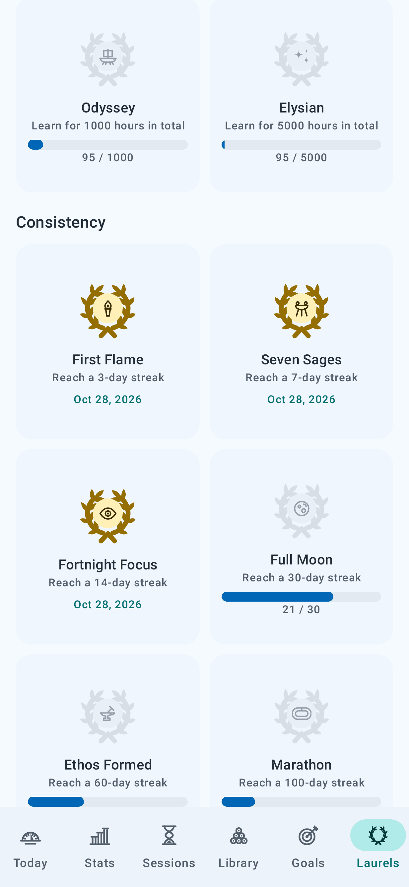 |

| Olive, dark | Marble background | Left rail, starry night | Readable + high contrast | Arabic (RTL) | Japanese | Greek |
|---|---|---|---|---|---|---|
| 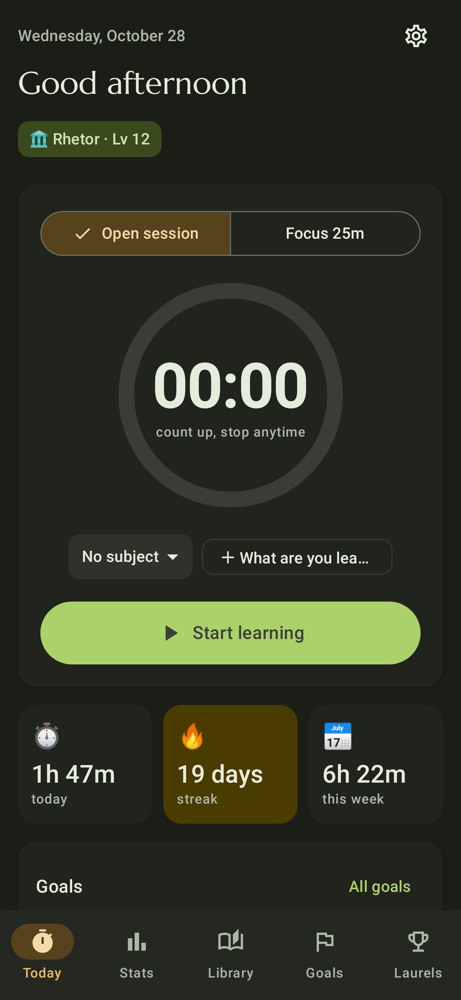 | 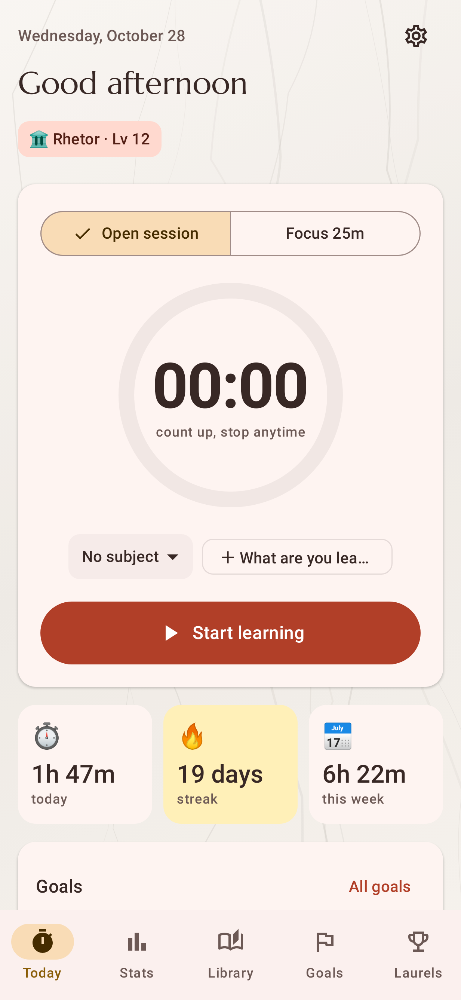 | 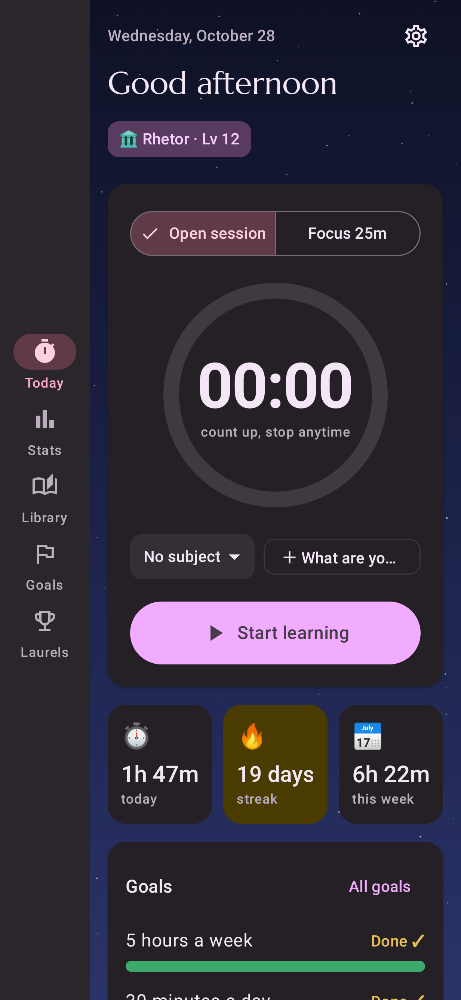 | 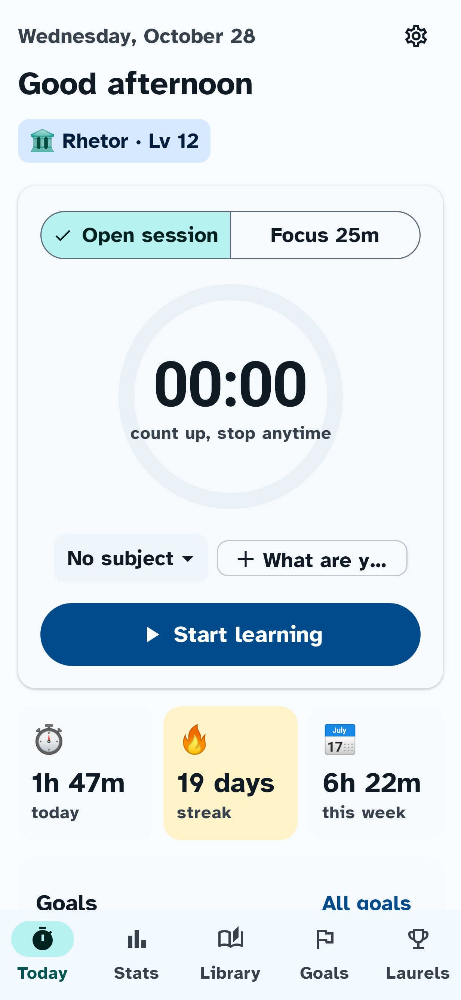 | 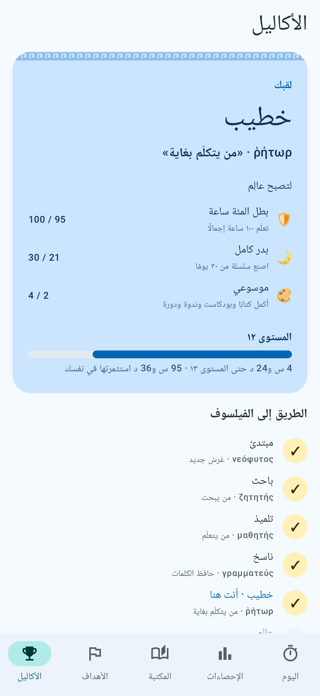 | 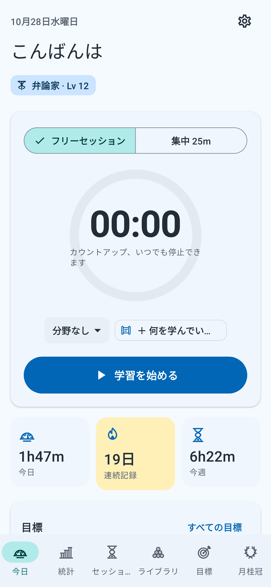 | 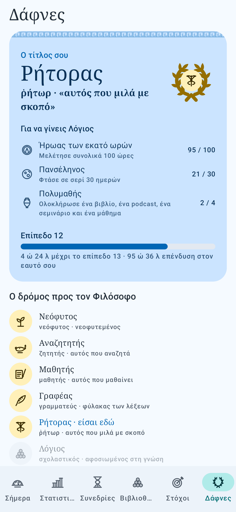 |

*Screenshots are rendered from the real app with demo data by `ScreenshotTest`, `PersonalizationScreenshotTest` and `LocaleScreenshotTest`.*

## Features

- **Learning timer** — open-ended stopwatch or focus blocks (default 25 min) with breaks. Runs from a saved timestamp, so it survives the app being closed or the phone rebooting. Forgot to press Start? Set a start time (quick picks or exact hours and minutes) and the open session counts up from there, with the session's start moved back to match. Ongoing notification with Pause / Stop & save actions. Discarding a running session asks first.
- **Reflection after every session** — 1–5 focus rating and "one thing I learned."
- **Stats** — day / week / month / year views, tap-to-inspect bar charts, subject breakdown, 18-week consistency heatmap.
- **Sessions** — every session grouped by day: what you studied, the date and start time, the length studied, focus rating and reflection. Filter by this week, month, year or subject, and log a past session (optionally linked to a library item). Tap a session to link it to a library item (its time then counts toward that item's progress), or change its subject, focus rating or reflection. Deleting a session always asks first and names the exact session.
- **Streaks with rest days** — configurable minimum minutes per day and rest days per week.
- **Goals** — study-time goals (daily / weekly / monthly) and "finish things" goals (e.g. 2 books a month, 12 books by Dec 31), with a hit-rate history.
- **Media run time** — enter the total length of audiobooks, podcasts, video courses and seminars, plus time already completed and playback speed. The timer shows live progress ("5:00:00 of 9:30:00 · 52%"), and time studied at 1.5× counts as 1.5× of the media.
- **Library** — books, audiobooks, podcasts, seminars, courses, videos, articles, plus **your own categories** (name, emoji, and progress unit — e.g. "Workshop" tracked in sessions). Ratings and takeaways. Add a web link (online seminar, audiobook, podcast or course page) and open it with one tap from the Library, the "Continue" cards and the running timer. Opening a link starts the stopwatch on that item (or resumes it, or saves whatever else was being timed and switches); this can be turned off in Settings. Pasting a link fills in the empty fields (title, author, type, run time, page count) from the page's own metadata (schema.org, Open Graph, oEmbed for YouTube/Vimeo/Spotify/SoundCloud), with Undo. **Your place in timed media:** a link with a start time (Share → "Start at 15:16") puts you at that spot, and sharing a link to Sophinity from YouTube, Vimeo, Spotify or a browser finds the matching library item, moves your place and starts the timer (or offers to add it). While timing, "I'm at…" sets your place by hand. Only the before-tracking part moves; logged study time never changes. **Mark as completed** (on the running timer, a library item, its Continue card, or a logged session) moves the item to Finished and credits the rest of its full length as study time, so a 41-minute video counts as 41 minutes whatever the playback speed; time already logged isn't counted twice, and a dialog shows the amount first.
- **Notes** — write as many notes as you like (ideas, quotes, questions), each optionally linked to a library item. Search them, filter by item, and see an item's notes right in its editor. Notes from the old single "Notes" box on library items move over automatically, including from older backups.
- **Titles, laurels and levels** — 51 Greek-themed laurels (milestones) for time invested (up to 5,000 hours), books (up to 1,000, audiobooks included), consistency, library, learning craft and goals. Laurels unlock **8 earned titles**: Neophyte → Seeker → Pupil → Scribe → Rhetor → Scholar → Sage → **Philosopher**. Levels track hours. Each laurel is a gold medallion inside a laurel wreath, and each title has its own emblem (sprout, oil lamp, wax tablet, quill, herald's staff, scrolls, herm, owl of Athena).
- **Original Greek artwork, no emoji** — 62 hand-drawn line icons (amphora, lyre, stoa, sundial, hourglass, owl, laurel and more) for library types, subjects, stats, the toolbar and badges. Subjects and categories pick from them; emoji saved by earlier versions are mapped to the closest icon automatically. Generated by `tools/make_glyphs.py`; contact sheet in `docs/brand/glyphs.svg`.
- **Daily wisdom** — a verified line from Greek thinkers (Socrates, Aristotle, Epictetus, Marcus Aurelius…) with its source, plus an evidence-based learning tip.
- **Home-screen widget** — today's time, streak, weekly goal, live ticking timer, one-tap start/pause.
- **Daily reminder** — set *when and where* you'll learn; skipped automatically on days you already have.
- **Make it yours** — seven Greek-inspired color themes (Aegean, Olive Grove, Terracotta, Tyrian Purple, Delphi Dawn, Starlit Agora, Marble), your phone's wallpaper colors, or any custom hue. Every theme is generated so text meets WCAG AA contrast in light and dark. Built-in backgrounds or your own photo, with dim and blur controls.
- **Accessibility** — text size up to 160%, bold text, a high-contrast mode (AAA-level text), reduce motion, and an optional Atkinson Hyperlegible font for low-vision readers. TalkBack, Switch Access and system font size are respected.
- **Toolbar your way** — at the bottom or as a rail on the left or right side; show or hide Stats, Library, Goals and Laurels; labels on or off.
- **21 languages** — English, Spanish, Brazilian Portuguese, French, German, Italian, Dutch, Polish, Russian, Ukrainian, Greek, Turkish, Arabic (full right-to-left layout), Hindi, Indonesian, Vietnamese, Thai, Japanese, Korean, and Simplified and Traditional Chinese. Follows the phone's language or can be picked in Settings (per-app language on Android 13+). Dates, durations and plurals use each language's own rules.
- **Backups that run themselves** — pick a folder once and Sophinity saves a fresh backup there every day (the last 14 are kept, so a bad day can be undone), with "Back up now" and a last-backup status. Files in a shared folder survive the app being uninstalled or its data cleared. Manual export can save to Google Drive, the app is included in Android's Google backup, and the welcome screen offers "Restore from a backup" on a new phone.
- **Settings from every page** — a gear in the top-right corner of every tab.
- **Drop-down menus or bubbles** — choices like item type, status, playback speed, goal period and filters are tidy drop-down menus; one switch in Appearance turns them all back into tappable bubbles.
- **Add media from the timer** — an "Add to library" button at the top of Today, next to your title, adds a book, podcast or course without leaving the timer, and selects it for the session.
- **Private by design** — no accounts, ads, or trackers. The only network use is reading a page whose link you paste into your library (can be turned off in Settings); no Sophinity server exists. Data stays on device, in Android Backup, and in JSON export/import. Database upgrades are covered by a migration test so existing data always carries over.

## The learning science behind it

| Design choice | Why |
|---|---|
| Rest days don't break streaks | Missing one day doesn't meaningfully derail habit formation (Lally et al., 2010); all-or-nothing streaks invite giving up after one slip. |
| "One thing I learned" prompt | Free recall is retrieval practice — one of the most robust ways to make learning stick. |
| Focus self-rating | Builds metacognition: noticing when and how you focus best. |
| Reminder asks *when and where* | Implementation intentions substantially increase follow-through. |
| Goal presets are specific and a bit ambitious | Specific, challenging goals beat "do your best" (Locke & Latham). |
| Weekly goals as the default | They flex around busy days, supporting autonomy. |
| Comparisons use the same point last week | Fair comparisons — never a partial week against a full one. |
| Earned titles need breadth | Each title requires time, reading, consistency *and* reflection, rewarding well-rounded learning over raw hours. |
| Daily learning tip | Spacing, interleaving, self-explanation, sleep, etc. — taught in small doses. |

## Build

Requirements: JDK 17+ and the Android SDK with platform 37.

```bash
./gradlew :app:assembleDebug          # debug APK -> app/build/outputs/apk/debug/
./gradlew :app:testDebugUnitTest      # unit tests + screenshot rendering
./gradlew :app:bundleRelease          # Play Store bundle -> app/build/outputs/bundle/release/
```

Screenshots are written to `app/build/screenshots/`.

Stack: AGP 9.4, Kotlin 2.4, Compose BOM 2026.09, Room, DataStore, WorkManager, Glance, Navigation (type-safe routes). Charts are hand-drawn on Canvas (no chart library). DI is a small hand-written `AppContainer`.

### Project layout

```
app/src/main/java/com/rayaurelius/sophinity/
  data/        Room entities & DAOs, repository, settings, backup format
  domain/      pure logic: streaks, goals, levels, laurels, titles, media time (unit-tested)
  timer/       timestamp-based timer, notifications, alarms, receivers
  reminders/   daily reminder (WorkManager)
  widget/      Glance home-screen widget
  ui/          Compose screens: today, stats, sessions, library, notes, goals, laurels, settings, onboarding
tools/         app icon (make_icon.py), Greek glyph set (make_glyphs.py) and store-asset renderer
tools/i18n/    translation pipeline and one plain-text file per language
```

### Translations

Every on-screen phrase lives in `app/src/main/res/values/strings.xml`. Translations are kept as simple `key = text` files in `tools/i18n/translations/` (one per language), which reviewers can edit without touching Android XML. Workflow:

```bash
python3 tools/i18n/i18n.py export       # after adding English strings: refresh translations/en.txt
python3 tools/i18n/i18n.py build        # check every language and regenerate res/values-*/strings.xml
python3 tools/i18n/i18n.py build de     # just one language
```

`build` fails if a key is missing, a placeholder (`%1$s`, `%d`) was changed or dropped, or a plural form that language needs is missing. That includes Arabic's six forms, and the rule that French, Portuguese, Hindi, Russian and Ukrainian must print the number in their "one" form. Never edit `res/values-*/strings.xml` by hand: they're regenerated.

The 20 non-English translations are machine-assisted. **Have a native speaker review each before launch** (start with your biggest markets). Each file opens with this note.

Fonts: the classical Marcellus headings and Atkinson Hyperlegible cover Latin-script languages. Greek, Cyrillic and Vietnamese switch to the system serif, and other scripts use the system font, so no word ever mixes typefaces.

## Releasing on Google Play

### 1. Signing
Create an upload key once and keep it safe (back it up — you need it for every update):

```bash
keytool -genkeypair -v -keystore upload.jks -alias upload -keyalg RSA -keysize 2048 -validity 10000
```

Create `keystore.properties` in the project root (git-ignored):

```
storeFile=upload.jks
storePassword=...
keyAlias=upload
keyPassword=...
```

Then `./gradlew :app:bundleRelease` produces a signed `.aab`. Enroll in **Play App Signing** when you upload.

### 2. Before the first upload
- [x] **Package name:** `com.rayaurelius.sophinity` (permanent once published).
- [ ] **Trademark:** web and app-store searches found no conflicting "Sophinity", but run a USPTO search (or ask an attorney) before you invest in the name. Avoid plain "Sophia" — it's a registered education mark.
- [ ] **Paid app:** set up a Google Play **payments/merchant profile** first. A paid app can later be made free, but a free app can't be made paid — so choose the price before publishing.
- [ ] Bump `versionCode` for every upload.
- [ ] Check the current Play **target API level** requirement (the app targets API 37).

### 3. Store listing & policy
- [ ] **Privacy policy URL** — required by Play. A short page stating no data is collected or shared is enough.
- [ ] **Data safety form** — answer *No data collected, no data shared*. JSON export is user-initiated to a location the user picks. The INTERNET permission is used only to fetch a page the user pasted a link to, at their request, and nothing about the user is sent with it.
- [ ] **Content rating questionnaire** — educational/productivity, no user-generated content shared.
- [ ] **Exact alarm permission** — the app declares `SCHEDULE_EXACT_ALARM` (user-grantable, off by default) only so focus/break alerts ring on time, and falls back to inexact alarms otherwise. If Play review pushes back, delete the permission line from the manifest; nothing else needs to change.
- [ ] Screenshots: start from `docs/screenshots/`, ideally retaken on a device with your own data.
- [ ] **Localized listings** — Play lets you add a translated title, description and screenshots per language. The in-app translations are a good source; have them reviewed along with the app strings.
- [x] Language splits are disabled in the bundle (`bundle { language { enableSplit = false } }`), so a language picked in Settings always has its strings installed.
- [x] Feature graphic (1024×500) and 512×512 icon: `docs/brand/`. Listing copy: `docs/brand/BRAND.md`.

## Roadmap ideas
- Spaced-review prompts that resurface old reflections and takeaways (retrieval practice over time)
- Year-in-review "learning wrapped" summary to share
- Wear OS tile for the timer
- Optional encrypted cloud sync across devices
- Learning partner / accountability sharing
- Share a title card ("I just became a Scholar") as an image
