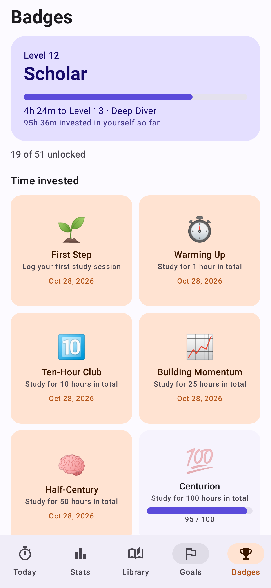
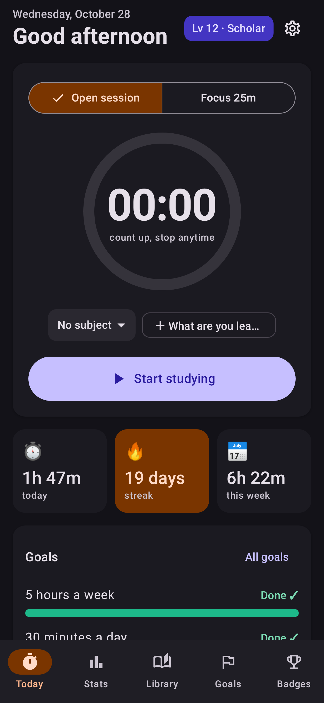
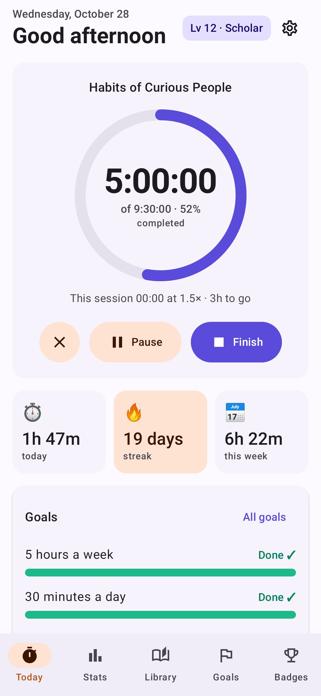

# Studybuddy

A study and learning tracker for everything you learn **outside formal schooling** — books, podcasts, seminars, courses, and self-directed study. Native Android, Kotlin + Jetpack Compose, Material 3, targeting **Android 17 (API 37)**.

| Today | Stats | Library | Goals | Badges | Dark | Timer on an audiobook |
|---|---|---|---|---|---|---|
|  |  |  |  |  |  |  |

*Screenshots are rendered from the real app with demo data by `ScreenshotTest`.*

## Features

- **Study timer** — open-ended stopwatch or focus blocks (default 25 min) with breaks. Runs from a saved timestamp, so it survives the app being closed or the phone rebooting. Ongoing notification with Pause / Finish actions.
- **Reflection after every session** — 1–5 focus rating and "one thing I learned."
- **Stats** — day / week / month / year views, tap-to-inspect bar charts, subject breakdown, 18-week consistency heatmap, session history.
- **Streaks with rest days** — configurable minimum minutes per day and rest days per week.
- **Goals** — study-time goals (daily / weekly / monthly) and "finish things" goals (e.g. 2 books a month, 12 books by Dec 31), with a hit-rate history.
- **Media run time** — enter the total length of audiobooks, podcasts, video courses and seminars, plus time already completed and playback speed. The timer shows live progress ("5:00:00 of 9:30:00 · 52%"), and time studied at 1.5× counts as 1.5× of the media.
- **Library** — books, audiobooks, podcasts, seminars, courses, videos, articles, plus **your own categories** (name, emoji, and progress unit — e.g. "Workshop" tracked in sessions). Ratings and takeaways.
- **Levels & 51 milestones** — time invested (up to 5,000 hours), books (up to 1,000, audiobooks included), consistency, library, learning craft, goals. Celebrations with confetti.
- **Home-screen widget** — today's time, streak, weekly goal, live ticking timer, one-tap start/pause.
- **Daily reminder** — set *when and where* you'll study; skipped automatically on days you already studied.
- **Private by design** — no accounts, ads, or trackers. Data stays on device, in Android Backup, and in JSON export/import. Database upgrades are covered by a migration test so existing data always carries over.

## The learning science behind it

| Design choice | Why |
|---|---|
| Rest days don't break streaks | Missing one day doesn't meaningfully derail habit formation (Lally et al., 2010); all-or-nothing streaks invite giving up after one slip. |
| "One thing I learned" prompt | Free recall is retrieval practice — one of the most robust ways to make learning stick. |
| Focus self-rating | Builds metacognition: noticing when and how you focus best. |
| Reminder asks *when and where* | Implementation intentions substantially increase follow-through. |
| Goal presets are specific and a bit ambitious | Specific, challenging goals beat "do your best" (Locke & Latham). |
| Weekly goals as the default | They flex around busy days, supporting autonomy. |
| "vs same point last week" | Fair comparisons — never a partial week against a full one. |
| Daily learning tip | Spacing, interleaving, self-explanation, sleep, etc. — taught in small doses. |

## Build

Requirements: JDK 17+ and the Android SDK with platform 37.

```bash
./gradlew :app:assembleDebug          # debug APK -> app/build/outputs/apk/debug/
./gradlew :app:testDebugUnitTest      # unit tests + screenshot rendering
./gradlew :app:bundleRelease          # Play Store bundle -> app/build/outputs/bundle/release/
```

Screenshots are written to `app/build/screenshots/`.

Stack: AGP 9.4, Kotlin 2.4, Compose BOM 2026.09, Room, DataStore, WorkManager, Glance, Navigation (type-safe routes). Charts are hand-drawn on Canvas (no chart library). DI is a small hand-written `AppContainer`.

### Project layout

```
app/src/main/java/com/rayaurelius/studybuddy/
  data/        Room entities & DAOs, repository, settings, backup format
  domain/      pure logic: streaks, goals, levels, milestones (unit-tested)
  timer/       timestamp-based timer, notifications, alarms, receivers
  reminders/   daily reminder (WorkManager)
  widget/      Glance home-screen widget
  ui/          Compose screens: today, stats, library, goals, badges, settings, onboarding
```

## Releasing on Google Play

### 1. Signing
Create an upload key once and keep it safe (back it up — you need it for every update):

```bash
keytool -genkeypair -v -keystore upload.jks -alias upload -keyalg RSA -keysize 2048 -validity 10000
```

Create `keystore.properties` in the project root (git-ignored):

```
storeFile=upload.jks
storePassword=...
keyAlias=upload
keyPassword=...
```

Then `./gradlew :app:bundleRelease` produces a signed `.aab`. Enroll in **Play App Signing** when you upload.

### 2. Before the first upload
- [ ] **Confirm the package name.** It's `com.rayaurelius.studybuddy` and can never change once published. Change `applicationId` and `namespace` in `app/build.gradle.kts` now if you want something else.
- [ ] **Paid app:** set up a Google Play **payments/merchant profile** first. A paid app can later be made free, but a free app can't be made paid — so choose the price before publishing.
- [ ] Bump `versionCode` for every upload.
- [ ] Check the current Play **target API level** requirement (the app targets API 37).

### 3. Store listing & policy
- [ ] **Privacy policy URL** — required by Play. A short page stating no data is collected or shared is enough.
- [ ] **Data safety form** — answer *No data collected, no data shared*. JSON export is user-initiated to a location the user picks.
- [ ] **Content rating questionnaire** — educational/productivity, no user-generated content shared.
- [ ] **Exact alarm permission** — the app declares `SCHEDULE_EXACT_ALARM` (user-grantable, off by default) only so focus/break alerts ring on time, and falls back to inexact alarms otherwise. If Play review pushes back, delete the permission line from the manifest; nothing else needs to change.
- [ ] Screenshots: start from `docs/screenshots/`, ideally retaken on a device with your own data.
- [ ] Feature graphic (1024×500) and 512×512 icon.

## Roadmap ideas
- Spaced-review prompts that resurface old reflections and takeaways (retrieval practice over time)
- Year-in-review "learning wrapped" summary to share
- Wear OS tile for the timer
- Optional encrypted cloud sync across devices
- Study buddy / accountability partner sharing
