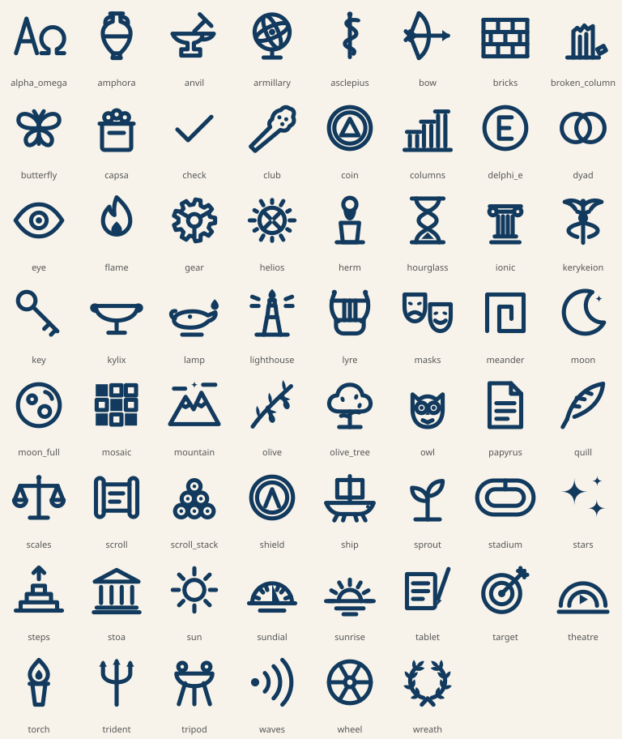

# Sophinity brand guide

## Name

**Sophinity** (so·FIN·ih·tee) = *Sophia* (σοφία, Greek for wisdom) + *infinity*: wisdom without end, for people who never stop learning.

- **Tagline:** Learning never stops.
- **Avoid:** plain "Sophia" (registered education trademark held by Sophia Learning, LLC) and owl mascots (strongly tied to Duolingo in learning apps).
- **Package:** `com.rayaurelius.sophinity`

## Voice

Encouraging, bright, and a little classical. We celebrate effort and steady progress, never shame a missed day. Greek touches are seasoning, not homework: always pair a Greek word with plain English ("Rhetor — one who speaks with purpose").

- Say **learn / learning**, not study (we serve adults, not school).
- Use **laurels** for milestones and **titles** for the Neophyte → Philosopher ladder.
- Quote only well-attested ancient sources, and always credit them (see `Wisdom.kt`).

## Colors: "Bright Sky over the Aegean"

| Role | Color | Use |
|---|---|---|
| Aegean (brand) | `#2F9BFF` | Icon, splash, feature graphic |
| Primary (UI) | `#0A6FD8` (light) / `#8FCBFF` (dark) | Buttons, rings, links (AA contrast) |
| Sea teal | `#14A8A6` | Icon gradient end, tonal controls |
| Laurel gold | `#FFD23F` / container `#FFF0B8` | **Achievement only**: laurels, titles, streak |
| Laurel green | `#1F7A47` (text) / `#3DAA6B` | Goals met |
| Ink navy | `#13294B` | Body text |
| Marble | `#F7FBFF` | Background |
| Olympic flame | `#E2683C` | Subject accent |

Gold is reserved for achievement so it keeps its meaning.

## Type

- **Headings:** Marcellus (flared classical serif; SIL Open Font License, see `licenses/Marcellus-OFL.txt`).
- **Body and numbers:** system sans (Roboto) for readability; timer digits stay bold sans.

## Icon

A gold laurel wreath around an open book, with a spark of insight, on an Aegean-to-sea gradient. Generated from `tools/make_icon.py` (Android vector + `icon.svg`), so app icon and store icon always match. Includes a monochrome layer for Android themed icons.

## Glyphs (the app's icon set)

No emoji anywhere: every icon is Sophinity's own Greek line art. 62 glyphs on a 24-unit grid with one stroke weight (1.7) and round caps, so they read as one family, like line work on painted pottery. They are tinted like any icon (primary, the subject's color, or gold for achievement).

- Library types: scroll (book), lyre (audiobook), theatre masks (podcast), stoa (seminar), wax tablet (course), theatre (video), papyrus (article), meander (other)
- Toolbar: sundial (Today), columns (Stats), hourglass (Sessions), scroll stack (Library), target (Goals), laurel wreath (Laurels)
- Laurels: a gold disc inside a laurel wreath when earned; a quiet grey outline while still ahead
- Title emblems: sprout, oil lamp, wax tablet, quill, herald's staff, scrolls, herm, owl of Athena

Source: `tools/make_glyphs.py` (edit there, then run it). Contact sheet: `docs/brand/glyphs.svg`.

## Titles (earned through laurels)

| # | Title | Greek | Meaning | Requires |
|---|---|---|---|---|
| 1 | Neophyte | νεόφυτος | newly planted | — |
| 2 | Seeker | ζητητής | one who seeks | First session |
| 3 | Pupil | μαθητής | learner | 10 hours, 7-day streak |
| 4 | Scribe | γραμματεύς | keeper of words | First book, 10 reflections |
| 5 | Rhetor | ῥήτωρ | one who speaks with purpose | 50 hours, 10 goal wins |
| 6 | Scholar | σχολαστικός | devoted to learning | 100 hours, 30-day streak, Polymath |
| 7 | Sage | σοφός | wise one | 500 hours, 50 books, 100-day streak |
| 8 | **Philosopher** | φιλόσοφος | lover of wisdom | 1,000 hours, 100 books, 365-day streak, 50 reflections |

## Play Store listing

- **Title (27/30):** Sophinity: Learning Tracker
- **Short description (78/80):** Track your lifelong learning. Earn laurels, rise from Neophyte to Philosopher.
- **Full description:**

> Learning never stops. Sophinity is the learning tracker for lifelong learners: the books you read, the audiobooks and podcasts you listen to, the seminars you attend, the courses you take, and every minute you invest in yourself.
>
> ⏱️ A learning timer with focus blocks, and live progress through audiobooks and courses ("5:00 of 9:30, 52%"), playback speed included.
> 📊 Daily, weekly, monthly and yearly stats, a consistency heatmap, and streaks that allow rest days.
> 🎯 Goals for time and for finishing things: "5 hours a week", "12 books this year".
> 📚 A library for books, audiobooks, podcasts, seminars, courses, plus categories you create.
> 🏛️ 51 laurels to earn, and titles from Neophyte to Philosopher.
> 📜 A line of wisdom each day from Socrates, Aristotle, Epictetus and more.
>
> Private by design: no accounts, no ads, no tracking. Your data stays on your device, and you can export it any time.

## Assets

- `icon.svg`: master icon
- `play-icon-512.png`: Play Store icon
- `play-feature-graphic.png`: 1024×500 feature graphic

Regenerate: `python3 tools/make_icon.py app/src/main/res docs/brand/icon.svg && node tools/render_store_assets.js .`
